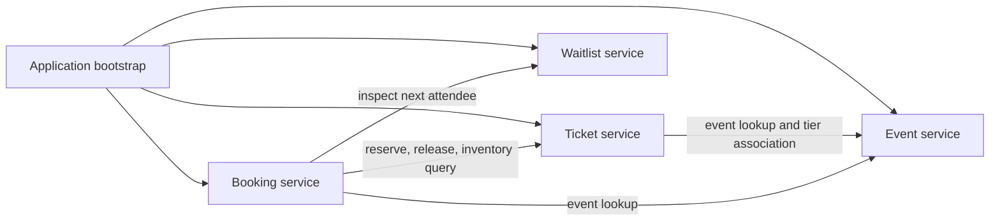

# Build 1 Architecture

Build 1 is a single Node.js process with independently owned domain modules and in-memory state. The structure establishes code ownership and explicit service contracts; it does not provide deployment or process-level microservice isolation.

## Runtime Flow

1. The event service creates an event in `draft` state and publishes it through an explicit state transition.
2. The ticket service validates a tier, checks its event through the event service interface, and associates the tier through that same interface.
3. The booking service accepts bookings only for published events and verifies that the tier belongs to that event.
4. The booking service validates quantity and total before requesting an inventory reservation. The ticket service is the only owner of capacity and reserved-quantity state.
5. Cancellation releases inventory through the ticket service, changes the pending booking to `cancelled`, and inspects (but does not remove) the next waitlisted attendee.

## Data and Consistency

Each service owns its Maps. Results crossing a service boundary are copied so callers cannot mutate stored records. Booking references are the keys in the booking lookup Map. The linked-list waitlist uses a Map of ticket-tier IDs to queue instances; it does not use an array as its queue.

Operations are synchronous and in memory. That makes each individual JavaScript call run to completion in this process, but it does not solve concurrent writes across processes, machines, or future database connections. A persistent implementation will need atomic storage operations and transaction or compare-and-set semantics for inventory and cancellation.

## Replacement Path

Bootstrap constructs services from explicit dependencies. Future persistence adapters can implement the same narrow operations used by the booking service, especially ticket lookup, reservation, release, and availability. HTTP routes, databases, payment handling, authentication, and asynchronous messaging are intentionally deferred.