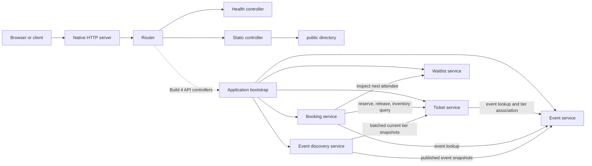

# Event Ticketing Architecture

Builds 1, 2, and 3 run in a single Node.js process with independently owned domain modules and in-memory state. The structure establishes code ownership and explicit service contracts; it does not provide deployment or process-level microservice isolation.

The dotted Build 4 path is a planned extension, not an implemented REST API. Current HTTP handling serves `/health` and static files only.

## Runtime Flow

1. The event service creates an event in `draft` state and publishes it through an explicit state transition.
2. The ticket service validates a tier, checks its event through the event service interface, and associates the tier through that same interface.
3. The booking service accepts bookings only for published events and verifies that the tier belongs to that event.
4. The booking service validates quantity and total before requesting an inventory reservation. The ticket service is the only owner of capacity and reserved-quantity state.
5. Cancellation releases inventory through the ticket service, changes the pending booking to `cancelled`, and inspects (but does not remove) the next waitlisted attendee.

## Data and Consistency

Each service owns its Maps. Results crossing a service boundary are copied so callers cannot mutate stored records. Booking references are the keys in the booking lookup Map. The linked-list waitlist uses a Map of ticket-tier IDs to queue instances; it does not use an array as its queue.

Operations are synchronous and in memory. That makes each individual JavaScript call run to completion in this process, but it does not solve concurrent writes across processes, machines, or future database connections. A persistent implementation will need atomic storage operations and transaction or compare-and-set semantics for inventory and cancellation.

## Replacement Path

Bootstrap constructs services from explicit dependencies. Future persistence adapters can implement the same narrow operations used by the booking service, especially ticket lookup, reservation, release, and availability. HTTP routes, databases, payment handling, authentication, and asynchronous messaging are intentionally deferred.

## Event Discovery (Build 2)

The Event Discovery Service owns query validation, text matching, filtering, result enrichment, and sorting. It does not create events, change publication state, or mutate ticket inventory. It obtains published event snapshots from `listPublishedEvents()` and, only when price or availability data is requested, obtains current tier snapshots through one `getTicketTiersForEvents(eventIds)` batch call. Event-only queries do not require Ticket Service at runtime.

The service filters event fields before asking for ticket snapshots, avoiding unnecessary batch work. It validates that the batch result matches each event's associated tier IDs and returns no partial results when a required dependency is unavailable. Errors are normalized to `DEPENDENCY_UNAVAILABLE`; user validation remains `VALIDATION`.

The application still executes all services in one process. A future independently deployed discovery service will need explicit network contracts, deadlines/timeouts, bounded retries where safe, circuit breaking, observability, and a policy for stale read models. None is introduced here.

## Booking State Machine (Build 3)

Booking Service owns each booking's status. Its transition guard is separate from HTTP routing. In this build, booking creation stores `pending`; the only enabled transition is `pending -> cancelled`, which releases the reserved inventory through Ticket Service before the new booking snapshot is stored. Invalid and unsupported transitions return `INVALID_STATE`.

Confirmation, refunds, and expiry are intentionally not implemented: payment is assigned to Build 4, while refund and expiry behavior is assigned to Build 8. Waitlist membership remains owned by Waitlist Service and is not a booking status.

## HTTP Foundation (Build 3)

`src/application/server.js` loads configuration and starts the server. `src/server/` owns HTTP routing, health response formatting, and static-file access; it does not import or mutate domain-service storage. `GET /health` is a liveness signal only. It does not verify dependencies or readiness. Future REST controllers can be added to the router and composed with `createApplication()` without moving business rules into HTTP handlers.

Static files are resolved under the configured `public/` root. Only allowlisted file types are served; path traversal and symlinks escaping the root are rejected, directories are not listed, and absent files return `NOT_FOUND`. The public directory contains only a repository marker until a later frontend build.