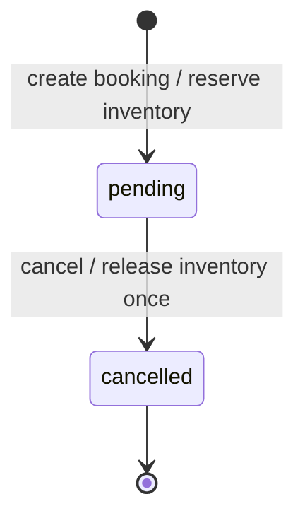

# Booking State Machine

Build 3 centralizes transition validation in `src/services/booking-service/booking-state-machine.js`. Booking records remain owned by Booking Service; the state machine does not own inventory and has no HTTP dependency.

## States

| State | Meaning in this project | Availability |
|---|---|---|
| `pending` | A booking was created and ticket inventory is reserved. Payment is not yet implemented. | Active in Build 3 |
| `cancelled` | A pending booking was cancelled and its reservation released once. | Active in Build 3 |
| `confirmed` | The future paid/confirmed booking state described by S07. | Reserved for Build 4; not emitted or reachable in Build 3 |
| `refunded` | A future refund outcome described by S09. | Reserved for Build 8; not emitted or reachable in Build 3 |
| `expired` | A future expired unpaid booking described by S10. | Reserved for Build 8; not emitted or reachable in Build 3 |

Waitlist membership and offers belong to Waitlist Service and are not booking states. Timed offers are reserved for Build 8.

## Transition Table

| Initial state | Action | Result | Conditions | Permitted in Build 3 | Inventory effect |
|---|---|---|---|---|---|
| None | Create booking | `pending` | Published event, matching tier, valid quantity, enough inventory | Yes, through `createBooking` | Reserve requested quantity before storing the booking |
| `pending` | Cancel | `cancelled` | Booking exists and is still pending | Yes, through `cancelBooking` | Release its quantity exactly once before storing the new state |
| `cancelled` | Cancel again | No change | Not applicable | No; `INVALID_STATE` | None |
| `cancelled` | Confirm/pay | No change | Payment is not implemented | No; `INVALID_STATE` | None |
| `pending` | Confirm/pay | No change | Payment confirmation belongs to Build 4 | No; `INVALID_STATE` | None |
| `pending` | Expire | No change | Expiry belongs to Build 8 | No; `INVALID_STATE` | None in Build 3 |
| `confirmed` | Cancel/refund | No change | Refund policy belongs to Build 8; exact final-state semantics follow that milestone's accepted policy | No; `INVALID_STATE` | None in Build 3 |
| Any terminal state | Any unsupported action | No change | Transition is not in the enabled transition table | No; `INVALID_STATE` | None |

## State Diagram

Only currently enabled transitions appear in the diagram. Future transitions are listed in the table, not drawn as active paths. The `confirmed` cancellation/refund outcome is deliberately not prescribed here: S09 describes cancellation and refund behavior, while Build 8 will define the full lifecycle and refund policy. The Build 3 implementation enables only `pending -> cancelled` and rejects all other action/state pairs with the existing `INVALID_STATE` code.

## Consistency

Cancellation first asks the transition guard for the permitted resulting state, then calls Ticket Service to release inventory, and only after successful release stores the cancelled booking. Since the booking's state changes after release and only `pending` can transition via `cancel`, retries cannot release it twice. This is an in-process synchronous guarantee; persistence and cross-process atomicity are future concerns.